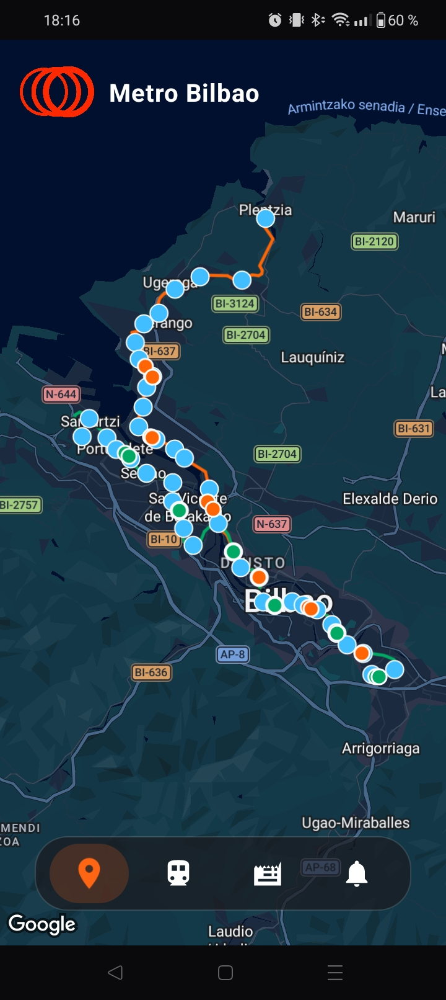
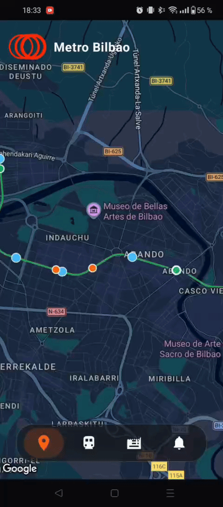
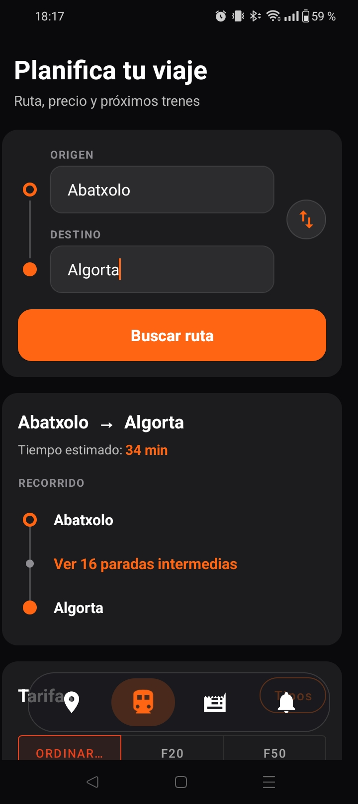
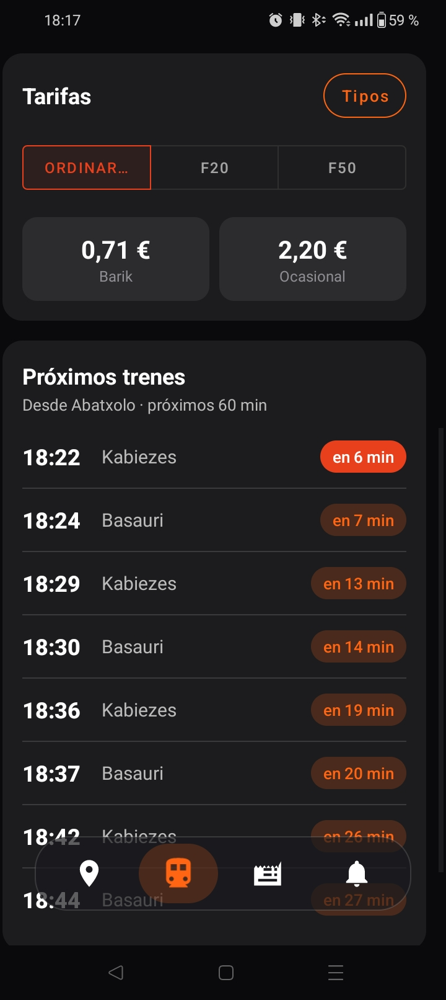
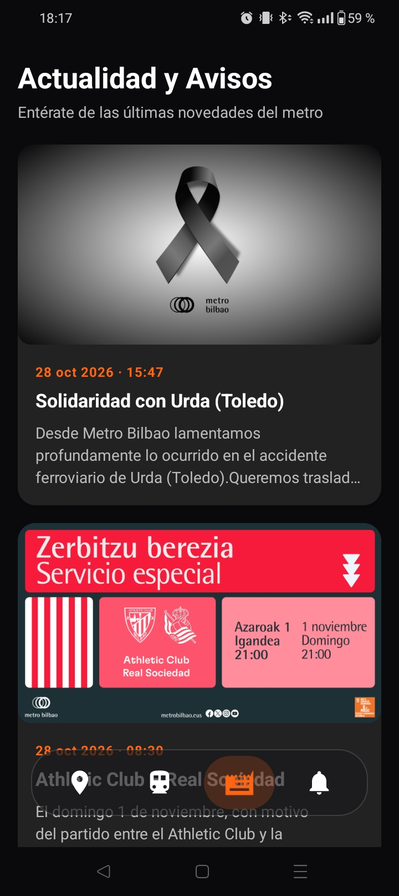
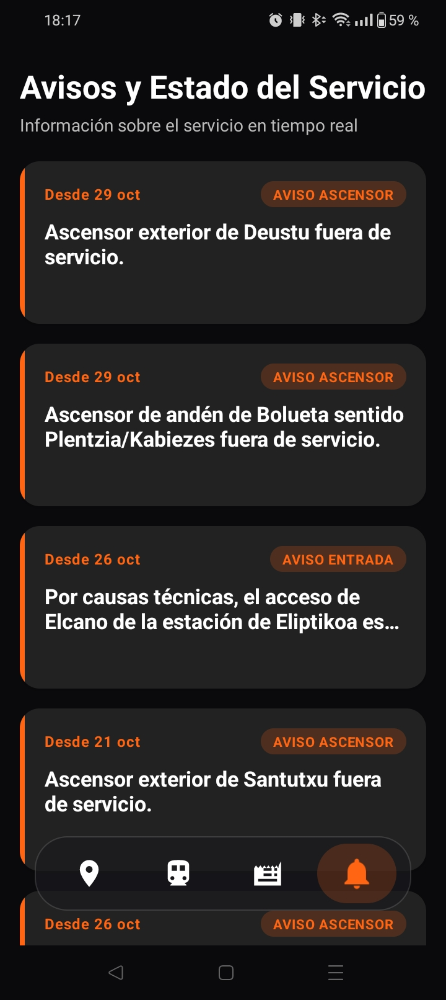

<h1 align="center">MetroBilbao</h1>

  Una app informativa sobre el Metro de Bilbao

<h2>Descripción del proyecto</h2>

  MetroBilbao es una aplicación nativa de Android escrita en Java que ofrece toda la información necesaria para navegar
  por las líneas de metro de Bilbao fácilmente. Desde planificar tu viaje, ver las noticias relevantes o simplemente
  mirar cómo los trenes se mueven por el mapa.

  La aplicación aún está en desarrollo y pendiente de mejoras. Los datos no son precisos en tiempo real debido a la
  falta
  de rastreadores en los trenes, pero la estimación está basada en los horarios oficiales de Metro Bilbao. Aplicación
  hecha como proyecto personal.

<h2>Características principales</h2>

<ul>
  <li>Java, XML y Kotlin</li>
  <li>Información sobre la posición estimada de los trenes, cómo llegar a ciertos sitios, los precios y las noticias.
  </li>
  <li>Diseño moderno y acorde a una estructura más accesible para las nuevas generaciones.</li>
</ul>

<h2>Capturas de la aplicación</h2>

<h3>Página principal (Mapa interactivo)</h3>

  

<h3>Trenes en movimiento</h3>

  

<h3>Planifica tu viaje</h3>

  
  

<h3>Noticias</h3>

  

<h3>Avisos</h3>

  

<h2>Tecnologías utilizadas</h2>

<ul>
  <li>Android</li>
  <li>Java</li>
  <li>Kotlin</li>
  <li>XML</li>
</ul>